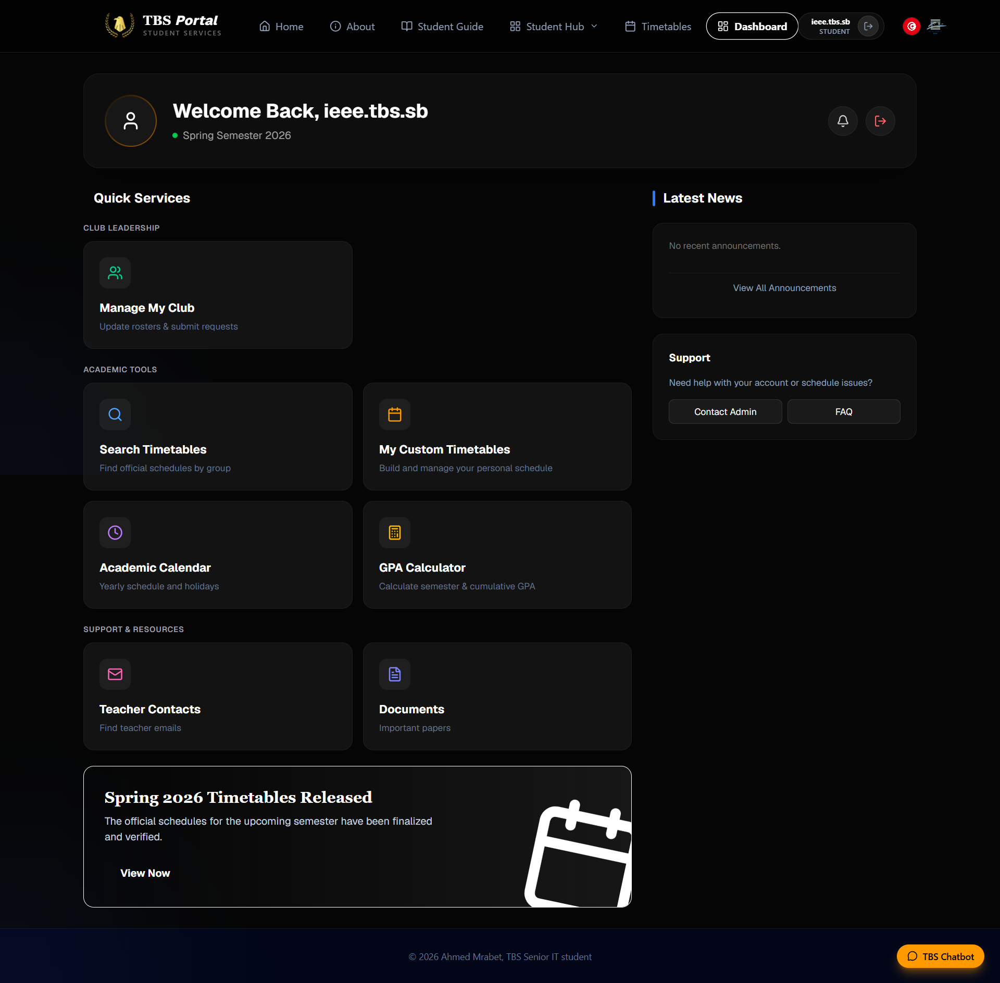
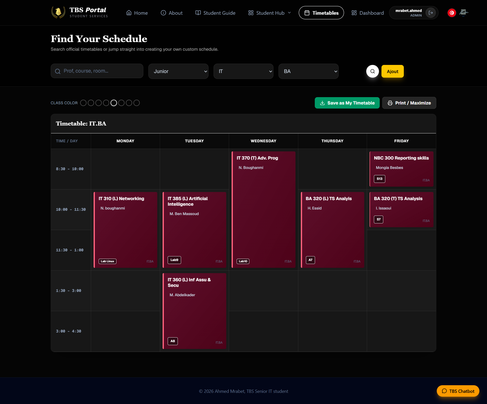
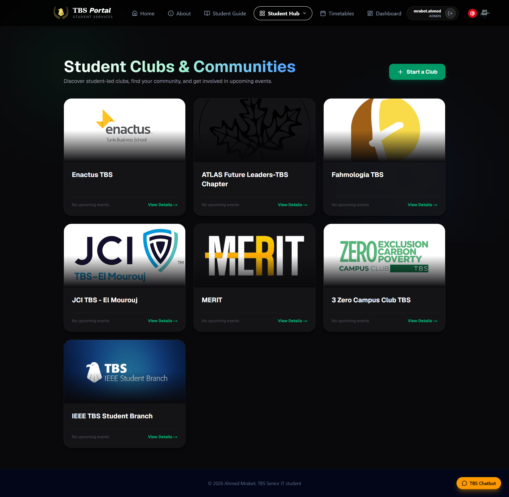
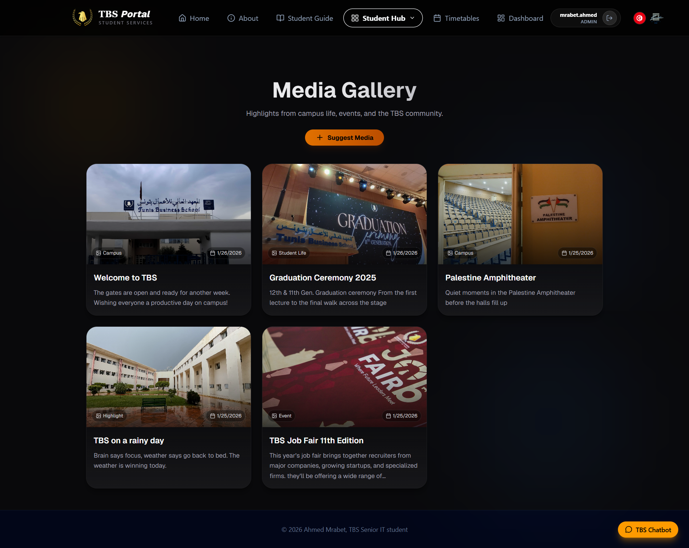

# TBS Portal - Tunis Business School Student Platform

<div align="center">


**A comprehensive student portal for Tunis Business School with AI-powered assistant**

[Live Portal](https://tbsportal.tn) · [Architecture](./ARCHITECTURE.md) · [Features](./FEATURES.md) · [Roadmap](./ROADMAP.md)

</div>

---

## 📸 Screenshots

<div align="center">

| AI Assistant | Home Page | Dashboard |
|:---:|:---:|:---:|
|  |  |  |

| Timetables | GPA Calculator | Clubs |
|:---:|:---:|:---:|
|  |  |  |

| Student Guide | Media Gallery | Restaurant |
|:---:|:---:|:---:|
|  |  |  |

| Login | Timetable Builder |
|:---:|:---:|
|  |  |

</div>

---

## 🎯 Project Overview

TBS Portal is a full-stack web application serving **600+ students** at Tunis Business School. It provides a centralized platform for academic resources, administrative services, and an AI-powered assistant that answers student questions using official university documents.

### Key Metrics

- 🎓 **600+** Active student users
-  **5** Knowledge sources (Handbook, Guide, Study, Decrees, Website)
-  **RAG-powered** AI assistant with anti-hallucination safeguards
- ⚡ **<3s** Response time for AI queries
- 💰 **$0.0005** Cost per AI query
-  **37** Synonym groups for query expansion

---

## ✨ Core Features

### 🤖 AI Assistant (Latest Feature)

The TBS AI Assistant is a Retrieval-Augmented Generation (RAG) system that answers student questions using official TBS documents.

**Capabilities:**
- Answers questions about academic policies, graduation requirements, attendance rules, and more
- Cites sources with document names and page numbers
- Indicates answer confidence (High/Medium/Low)
- Supports Arabic, French, and English
- Never hallucinates — only uses provided documents
- Maintains conversation context for follow-up questions

- **Live DB Queries** — Club presidents, teacher emails, course catalog, calendar events, restaurant menus
- **Content Blocking** — Prevents repeated entries in responses

**Knowledge Sources:**
1. TBS Student Handbook (54 pages, 39 chunks) — Official policies
2. TBS Student Guide (86 pages, 50 chunks) — Student resources
3. TBS Graduate Career Study 2023 (5 pages, 5 chunks) — Survey data
4. TBS Official Website (crawled pages) — Publications, forms, faculty
5. Manual Q&A (admin-curated) — Gap filling

### 📋 Student Services

- **Timetable Management** — View and manage class schedules with OCR extraction
- **Grade Tracking** — GPA calculator and academic performance monitoring
- **Teacher Directory** — Contact information for faculty members
- **Club Management** — Student organizations with approval workflows
- **Restaurant Menus** — Daily lunch menus
- **Academic Calendar** — Important dates and deadlines
- **Document Center** — Official forms and resources
- **Exam Schedules** — Exam timetables with OCR extraction

### 👨‍💼 Admin Dashboard

- Knowledge source management (upload PDFs, monitor status)
- Manual Q&A curation
- Unanswered question tracking
- Feedback analytics (👍/👎)
- User management and audit logs

---

## ️ Architecture

See [ARCHITECTURE.md](./ARCHITECTURE.md) for detailed technical documentation.

### High-Level Overview

```
┌─────────────────────────────────────────────────────────────┐
│                    Frontend (Next.js 16)                     │
│  ┌──────────────┐  ┌──────────────┐  ┌──────────────────┐  │
│  │   Student    │  │   Admin      │  │   AI Assistant   │  │
│  │   Pages      │  │   Dashboard  │  │   Chat UI        │  │
│  └──────────────┘  └──────────────┘  ──────────────────┘  │
└─────────────────────────────────────────────────────────────┘
                              │
                    HTTPS / SSE Stream
                              │
┌─────────────────────────────────────────────────────────────┐
│                   Backend (FastAPI)                          │
│  ┌──────────────┐  ┌──────────────┐  ┌──────────────────┐  │
│  │   REST API   │  │   RAG        │  │   Ingestion      │  │
│  │   Endpoints  │  │   Pipeline   │  │   Service        │  │
│  └──────────────┘  └──────────────  └──────────────────┘  │
└─────────────────────────────────────────────────────────────┘
                              │
                    PostgreSQL + pgvector
                              │
┌─────────────────────────────────────────────────────────────┐
│                  Azure Services                              │
│  ┌──────────────┐  ┌──────────────┐  ┌──────────────────┐  │
│  │   App        │  │   OpenAI     │  │   Blob Storage   │  │
│  │   Service    │  │   (GPT-4o)   │  │   (PDFs)         │  │
│  └──────────────┘  └──────────────┘  └──────────────────┘  │
└─────────────────────────────────────────────────────────────┘
```

---

## 🛠️ Tech Stack

### Frontend
- **Framework:** Next.js 16.1.4 (App Router)
- **Language:** TypeScript (strict mode)
- **Styling:** Tailwind CSS v4
- **State Management:** React Context API
- **Icons:** Lucide React
- **Deployment:** Azure App Service

### Backend
- **Framework:** FastAPI
- **Language:** Python 3.10
- **Database:** PostgreSQL 16 + pgvector
- **ORM:** SQLAlchemy + Alembic migrations
- **AI/ML:** Azure OpenAI (GPT-4o/4.1/5-mini, text-embedding-3-small)
- **PDF Processing:** PyMuPDF
- **Deployment:** Azure App Service (Gunicorn + Uvicorn)

### Infrastructure
- **Hosting:** Azure App Service (Frontend + Backend)
- **Database:** Azure PostgreSQL Flexible Server
- **AI Models:** Azure AI Foundry
- **Storage:** Azure Blob Storage
- **CI/CD:** GitHub Actions
- **Email:** Resend (transactional)

---

## 🚀 Development Milestones

See [ROADMAP.md](./ROADMAP.md) for complete development timeline.

### Completed Milestones

- ✅ **Milestone 0:** Foundation (Docker, pgvector, test framework)
- ✅ **Milestone 1:** Ingestion Pipeline (PDF → embeddings)
- ✅ **Milestone 2:** Core RAG (retrieval + generation)
- ✅ **Milestone 3:** Chat UI (student-facing interface)
- ✅ **Milestone 5:** Feedback Loop (admin dashboard, Q&A)

### In Progress

-  **Milestone 4:** Polish & Launch (rate limiting, E2E tests)

---

## 📊 Project Statistics

| Metric | Value |
|--------|-------|
| Total Lines of Code | ~15,000+ |
| Backend Endpoints | 40+ |
| Frontend Pages | 25+ |
| Database Tables | 20+ |
| Alembic Migrations | 35+ |
| Test Coverage | ~70% (unit tests) |
| AI Response Time | < 3 seconds |
| Monthly AI Cost | ~$5 |

---

## 🔐 Security Features

- JWT authentication with 45-minute expiry
- bcrypt password hashing
- Rate limiting (5 login attempts/minute)
- Admin action audit logging
- Prompt injection protection
- CORS whitelisting
- Environment variable management

---

## 📈 Performance

- **Page Load:** < 2 seconds (LCP)
- **AI Response:** < 3 seconds (first token)
- **Database Queries:** < 50ms (vector search)
- **Concurrent Users:** 50+ supported
- **Uptime:** 99.5%

---

##  Design System

- **Primary Color:** TBS Gold (#D4AF37)
- **Background:** Deep Black (#050505)
- **Font:** Inter (sans-serif), Playfair Display (serif)
- **Theme:** Dark mode throughout
- **Responsive:** Mobile-first design

---

## 📝 Documentation

- [Architecture Details](./ARCHITECTURE.md)
- [Feature Documentation](./FEATURES.md)
- [Development Roadmap](./ROADMAP.md)
- [API Reference](./API.md)
- [Deployment Guide](./DEPLOYMENT.md)

---

##  Contributing

This is a production application for Tunis Business School. For bug reports or feature requests, please contact the development team.

---

## 📄 License

Private repository - Tunis Business School © 2026

---

<div align="center">

**Built with ❤️ for TBS Students**

[Report Issue](https://github.com/ahmed-mr1/TBS-System/issues) · [Request Feature](https://github.com/ahmed-mr1/TBS-System/issues)

</div>
